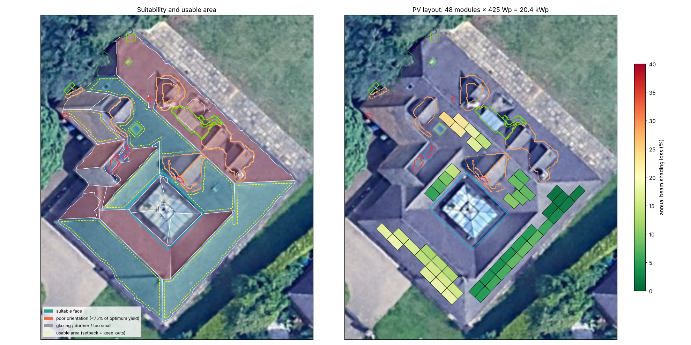

# roofsolar — 3-D roof reconstruction & PV panel placement from DSM + RGB

**Author:** Abu Bakar Abdullah ([@abubakarabdullah014](https://github.com/abubakarabdullah014))

A Python pipeline that takes a **Digital Surface Model** and an **RGB orthophoto**
and produces:

* elevation, **slope** and **aspect/azimuth** rasters
* a segmentation of the roof into **planar faces**, with ridges / hips / valleys
  computed as exact plane–plane intersections, and a **watertight, piece-wise planar
  roof** (regularised DSM)
* **obstructions** (chimneys/vents, dormers, raised skylights/lanterns, flush roof
  windows, overhanging vegetation) from DSM height residuals + RGB colour analysis
* a **3-D model** (GLB / OBJ / interactive HTML) of roof, walls, obstructions and modules
* a **PV module layout** at true size on each inclined plane, respecting edge
  setbacks, obstruction clearances, orientation (yield) and DSM-ray-cast shading —
  with an automatic constraint checker.

Result on the assessment data (10 cm, EPSG:32630, ~52.28° N):

| | |
|---|---|
| roof faces | 24 planes, MAE 5.8 cm, 89 % of roof pixels within 10 cm |
| seams (ridges/hips/valleys) | gap p95 ≈ 2·10⁻⁹ m (watertight, was 0.78 m before vertex snapping) |
| obstructions | 20 (5 chimney/vent, 6 dormer, 1 lantern, 5 roof windows, 3 tree overhangs) |
| PV layout | **48 × 425 Wp = 20.4 kWp** on 4 faces (SW & SE), mean beam shading loss 10 % |
| constraint check | **PASS – 0 violations** (sizes, planarity, setback, clearance, overlap) |



---

## 1. Setup

Python ≥ 3.10.

```bash
git clone https://github.com/abubakarabdullah014/Solar-Potential.git && cd Solar-Potential
python -m venv .venv && source .venv/bin/activate      # Windows: .venv\Scripts\activate
pip install -r requirements.txt
# optional, for static 3-D PNG renders and the turntable video:
python -m playwright install chromium                  # and have ffmpeg on PATH
```

Put the three rasters in `data/` (names below) or pass paths on the command line:

```
data/dsm_full.tif      full DSM  (reference grid)
data/dsm_clipped.tif   DSM clipped to the parcel (used as area-of-interest mask)
data/rgb.tif           RGB orthophoto on the same grid
```

## 2. Run

```bash
python -m roofsolar --out outputs                # whole pipeline (~30 s)
python -m roofsolar --out outputs --turntable    # + rotating 3-D MP4
python -m roofsolar --no-render                  # no headless browser available
python -m roofsolar --config my.json             # override parameters, e.g.
#   {"solar": {"edge_setback": 0.4, "panel_length": 1.762, "panel_width": 1.134}}

pytest -q                                        # 19 unit + integration tests
python experiments/robustness.py                 # noise / missing-data study (~2.5 min)
```

Open `outputs/model/roof_model_3d.html` in a browser for the interactive 3-D model.

## 3. Outputs

```
outputs/
├── report.json              all metrics, validation, timings, full config used
├── face_summary.csv         per face: slope, aspect, areas, relative yield, #modules, kWp, reason if excluded
├── robustness.md / .csv     results of experiments/robustness.py
├── figures/
│   ├── 01_inputs.png                    RGB, DSM, nDSM + footprint + vegetation
│   ├── 02_elevation_slope_aspect.png
│   ├── 03_roof_faces_and_edges.png      faces, ridges/hips/valleys/steps, aspect arrows
│   ├── 04_regularization.png            input vs piece-wise planar roof, residual, cross-section
│   ├── 05_obstructions.png
│   ├── 06_panel_layout.png              suitability, usable area, modules coloured by shading
│   ├── 07_3d_perspective.png, 08_3d_top.png
├── rasters/   dsm_clean, slope_deg, aspect_deg, ndsm, roof_faces, roof_planes_dsm, dsm_regularized (GeoTIFF)
├── vectors/   roof_faces, roof_edges, obstructions, panels (GeoJSON, EPSG:32630; panels carry 3-D corners)
└── model/     roof_model.glb / .obj, roof_model_3d.html, turntable.mp4, origin.json (local-frame origin)
```

## 4. Code structure

```
roofsolar/
├── config.py        every threshold, with units and rationale
├── io.py            raster loading, co-registration onto the DSM grid
├── preprocess.py    robust outlier detection (MAD), harmonic (Laplace) inpainting
├── terrain.py       Horn slope / aspect / normals, masked Gaussian
├── building.py      DTM (morphological opening), nDSM, ExG+Otsu vegetation, footprint
├── segmentation.py  region growing on normals, merging, robust plane fit, competitive
│                    assignment, convex/concave edge classification, envelope relabelling
├── geometry.py      polygonisation, coverage simplification, plane intersections,
│                    vertex snapping (watertight seams), PlaneFrame (map ↔ in-plane coords)
├── obstructions.py  DSM residual + RGB (Lab) glazing / shadow / vegetation analysis
├── solar.py         sun geometry, relative yield, exact row-interval packing, ray-cast shading
├── mesh3d.py        LoD2-style mesh (facets, walls, prisms, modules), exports, renders
├── validation.py    reconstruction metrics and hard constraint checks for every module
├── pipeline.py      orchestration and file outputs
├── viz.py           figures
└── synthetic.py     synthetic hip roof with known ground truth (tests)
tests/               unit tests (math) + integration test on the assessment data
experiments/         robustness study
docs/TECHNICAL_REPORT.md   approach, algorithms, assumptions, limitations
```

See **[docs/TECHNICAL_REPORT.md](docs/TECHNICAL_REPORT.md)** for the method, the maths, the
validation and the limitations.
